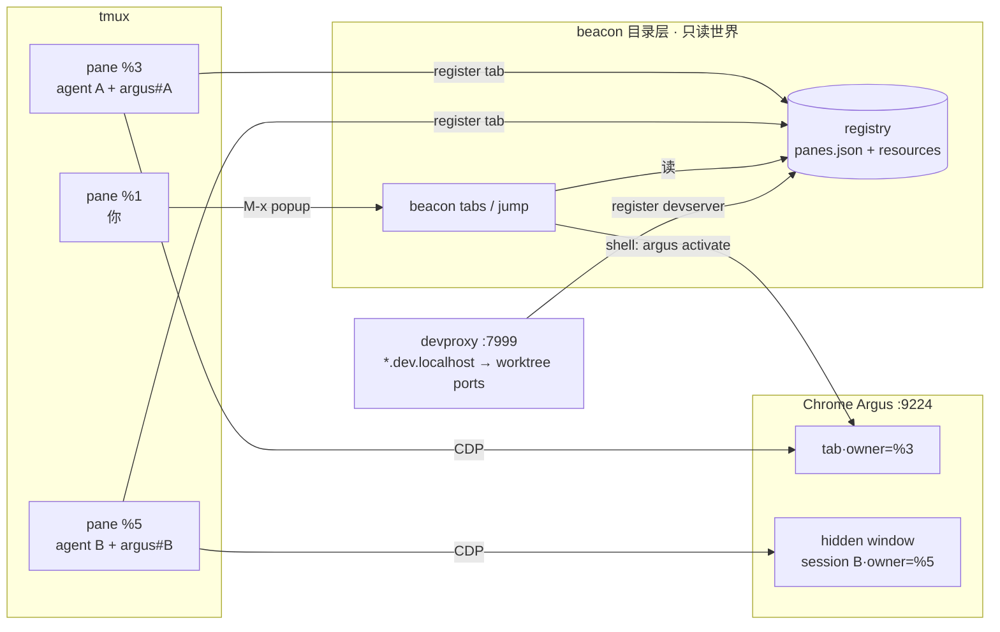
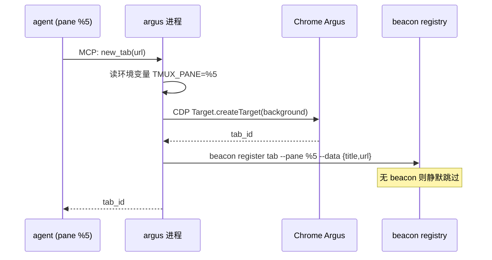
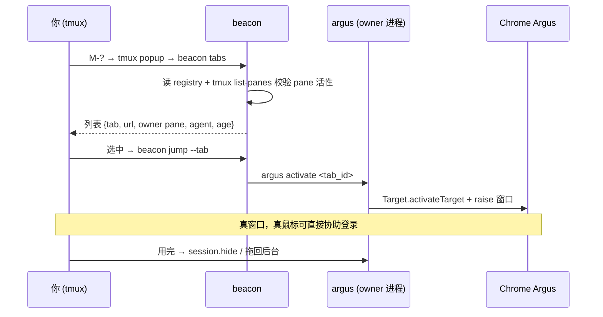
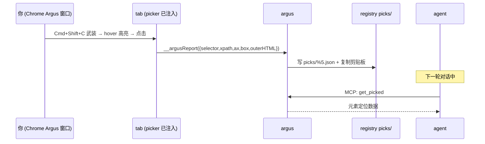
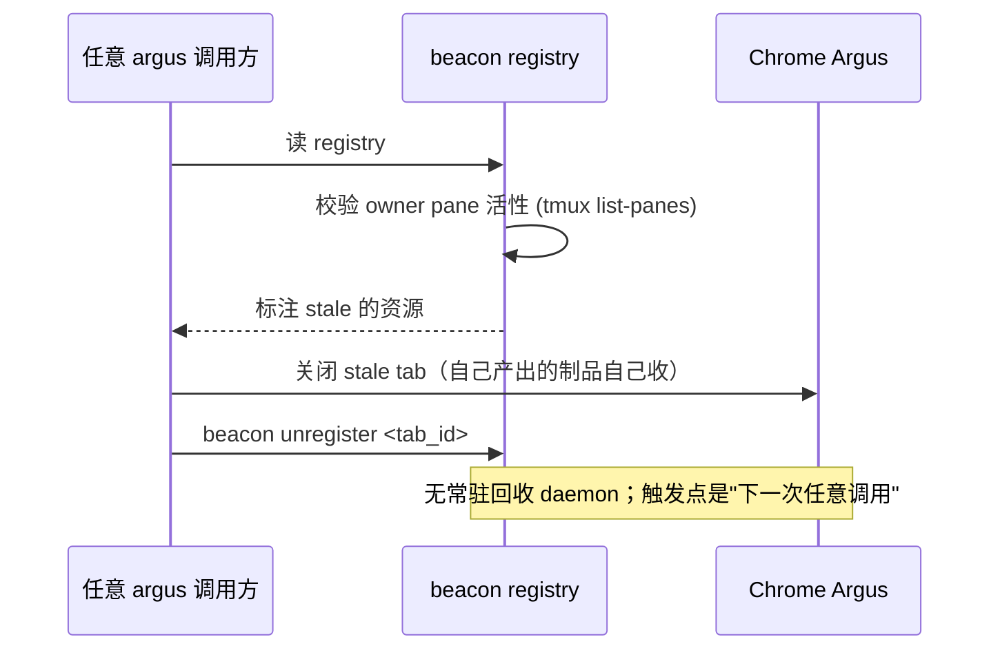
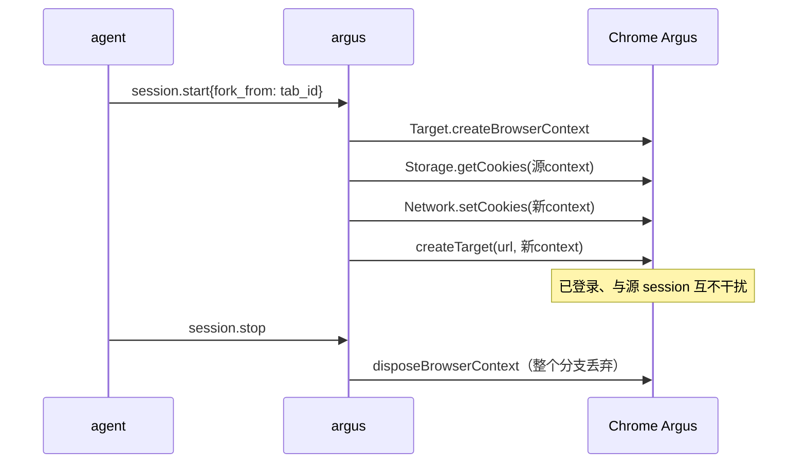
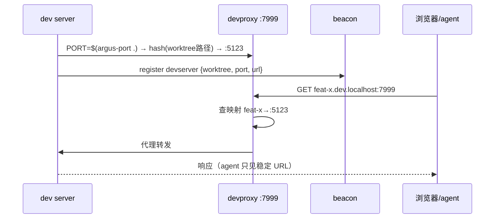

# Agent Session 与 tmux 联动设计讨论稿

> 记录日期：2026-10-13
> 状态：讨论稿，未实施
> 背景：用户日常浏览器为 Firefox，Chrome Argus 专职作为 agent 浏览器；工作流深度依赖 tmux

## 1. Chrome Argus 定位

- 用户不需要"日常 Chrome"，`/Applications/Chrome Argus.app` 是 agent 专用浏览器（独立 bundle ID `com.tangtszho.chrome-argus`，独立 TCC 权限、Dock 身份）
- 现 bundle 是 Chrome 151 的手工复制 + 自编译 stub（硬编码 framework 版本 `151.0.7922.138`），不自动更新，属不可复现的手工作品
- 待决：脚本化重建（copy Google Chrome.app + 动态解析 framework 版本的 stub + 改写 Info.plist），或干脆直接 exec 系统 Chrome binary

## 2. 核心需求

agent 在 tmux pane 中运行，通过 argus 操作 Chrome Argus 中的 tab。要求：

1. agent tab 不抢占用户的鼠标/屏幕焦点
2. tab 能"注册"——知道是哪个 tmux pane / agent 开的
3. 用户有一个统一入口查看所有 agent tab 并快速跳转（监管、协助登录）
4. 生命周期：agent/pane 消失后其 tab 能被回收

## 3. 设计要点（共识）

### 3.1 不抢鼠标/屏幕

CDP 输入是合成事件（`Input.dispatchMouseEvent` / `dispatchKeyEvent`），从不动真实光标、不需窗口焦点；`configuredFocus=false` 已保证 tab 后台创建。剩余问题是 agent tab 出现在用户可见窗口中 → 由"专属窗口 + 隐藏/唤起"或 headless 隔离解决。

### 3.2 注册 = 环境自动标记

MCP stdio 模式下 argus 进程由 agent client 拉起，**继承 pane 的环境变量**：

- `TMUX_PANE`（如 `%5`）天然就是 session key
- argus 启动时读取 `TMUX_PANE`，本进程创建的所有 tab 自动打上 `{owner_pane, agent_name, created_at}` 标签
- registry 存 `~/.config/argus/registry/`（JSON 文件 + 文件锁，任何 argus 进程可读写）

### 3.3 生命周期 = pane 活性（不需要心跳协议）

不用显式心跳/TTL：**pane 存在性即租约**。

- 惰性 GC：任何 argus 进程读 registry 时用 `tmux list-panes -a` 校验 owner pane 存活；死 pane 的 tab 就地关闭并清记录
- 无独立 daemon，崩溃安全：argus 进程死掉 → 下次任意调用触发 GC

### 3.4 监管入口（快速跳转）

两种互补形态：

- **tmux popup**：`tmux display-popup -E` 跑 `argus tabs`（CLI 读 registry 输出列表），选中 → `argus activate <tab_id>`（CDP `Target.activateTarget` + raise Chrome Argus 窗口）。列表项可附加动作：跳 tab / `tmux select-pane` 跳回 agent pane
- **Chrome 内 dashboard tab**：argus 内置轻量 HTTP listener 渲染 tab 注册表页面，pinned tab 常驻当"任务管理器"

反向：tmux status bar 可挂 `#(argus tabs --count)` 显示活跃 agent tab 数。

### 3.5 session 模式

- `attached`：Chrome Argus 内专属窗口（默认隐藏），共享登录态，可 `reveal`/`hide` 切换可见性——适合监管、协助登录
- `isolated`：独立 headless Chrome 进程 + 临时 profile——适合纯 UI 测试，但与 shared registry 模型需协调归属

隐藏窗口的节流问题靠启动 flag：`--disable-backgrounding-occluded-windows` `--disable-renderer-backgrounding` `--disable-background-timer-throttling` + CDP `Emulation.setFocusEmulationEnabled`。

## 4. 资源消耗（MacBook Air 约束）

- 每 tab ≈ 一个 renderer 进程（普通页面 100–400MB RSS）；共享单实例下 Chrome 本体 ~500MB 摊薄
- **共享实例比每 agent 独立 Chrome 省**：独立实例每个额外负担 browser/GPU/network-service 进程（300–500MB+）
- 缓解手段：
  - tab 复用：navigate 代替 new_tab
  - `mock_route` 拦截图片/媒体/字体（UI 测试不需要）
  - `Emulation.setCPUThrottlingRate` 限流
  - Chrome Memory Saver 自动 discard 后台 tab
  - registry 层加并发上限（如最多 3 个活跃 session）
- 量级估计：16GB Air 上共享实例 5–8 个 agent tab 无压力

## 5. worktree 端口冲突与路由

多 worktree 并行开发时 dev server 端口互撞。两层方案：

- **确定性分配**：`port = base + hash(worktree路径) % 区间`，同一 worktree 恒得同一端口，无需协商，删 worktree 自动释放。入口：`PORT=$(argus-port .) npm run dev`
- **统一路由**：固定入口端口（如 :7999）的轻量反向代理，`*.dev.localhost` 子域名 → 各 worktree 实际端口。`localhost` 通配天然解析 127.0.0.1，无需改 /etc/hosts；子域名路由不破坏 cookie 域与绝对路径资源
- agent 永远引用稳定 URL（如 `http://feat-x.dev.localhost:7999`），与真实端口解耦；session registry 中的 session↔URL 关系获得语义锚点

## 6. 用户→agent 反向通道

### 6.1 element picker（"点元素发 agent"）

- Chrome Argus 每个新 tab 经 `Page.addScriptToEvaluateOnNewDocument` 注入常驻 picker 脚本
- 快捷键唤起 → hover 高亮 → 点击捕获 `{selector, xpath, a11y ref, bounding box, outerHTML 摘要}`
- 写入 registry `picks/` + 复制剪贴板；agent 侧 `get_picked` 工具或 `argus last-pick` CLI 读取
- 纯 CDP 注入实现，无需浏览器扩展；agent 专用浏览器可占用 Cmd+Shift+C 等快捷键

### 6.2 操作录制（trace，非视频）

- 拒绝 `Page.startScreencast` 视频思路——对 agent 低信噪比
- 录制**语义动作轨迹**：注入捕获监听器（`Runtime.addBinding` 回传）记录真实用户输入 → `{click selector, fill value, navigation}` 序列
- 复用现有 `recorder.go` 证据体系；产出可回放 trace，agent 用 `batch_actions` 确定性重放
- 密码字段默认脱敏；`addScriptToEvaluateOnNewDocument` 保证跨导航不漏

## 7. 架构重定位（2026-10-13 补充）

讨论后的分层结论——**registry 不建在 argus，建在 beacon**：

- **beacon** ＝ agent 会话目录 + 用户 UX：pane 是主实体，tab/dev server/pick/trace 是 pane 的资源外键；复用已有 `panes.json`、cleanup、jump、通知基础设施。约束：beacon 只持"描述性状态"，不持"动作"（保持 observe-don't-orchestrate 定位）
- **argus** ＝ 浏览器能力层（actuator）：CDP 操作、session spawn、picker、recorder；通过 shell-out 契约向 beacon 上报资源（`beacon register tab {...}`），beacon 不在则静默跳过，保持独立可用
- **devproxy** ＝ 独立小工具：失败域不同（beacon 挂了 dev server 不能失联），只向 beacon 注册映射表
- **tmux.conf** ＝ 纯胶水：只放 keybinding 和展示，业务逻辑进二进制；**现状已冗余**（失效快捷键、膨胀 scripts/），待清理

issue 归属调整（待执行）：
- #11 registry → 挪到 beacon 仓库（argus 仅 producer）
- #14 拆分：列出/跳转归 beacon（`beacon tabs`/`beacon jump --tab`），activate 归 argus
- #12/#13/#15/#16 留 argus；#17 独立工具；#18 独立

## 7.1 讨论决议（第二轮）

- **微信开发者工具**：暂不纳入，记为 deferred；核心流程跑通后再评估
- **并发裁决归 argus**：不引入跨 agent 仲裁者。argus 自行按资源消耗判断——长期闲置的 session 可回收（kill Chrome/释放），回收不掉则拒绝新建 session。beacon 只读状态，不做裁决
- **picker/record 注入策略**：常驻注入的代价是每次导航执行一次空转脚本（武装前只有 keydown 监听），开销可忽略 → **全 tab 注入**。CDP 注入脚本不受页面 CSP 限制
- **Devin send-element 实现分析（重要）**：Devin Desktop Preview 不是往 tab 注入，而是**代理你的 dev server**——listener 在代理层注入到被服务的 HTML 中，点击元素序列化 `{outerHTML, computed styles, 最近的 React/Vue 组件边界}` 变成 prompt @mention，console error 同理。启示：**注入可以发生在 dev.localhost 代理层而非 CDP 层**——好处是浏览器无关（Firefox 日常浏览器也能点元素发 agent）、与 tab/session 解耦。两层可并存：代理层负责"用户随手发元素"，CDP 层负责 agent session 内的录制与精确操作
- **ARGUS_ATTACH 兼容**：旧行为降级为特例——"默认 session = 9224 共享实例"，现有工具签名不变；session_id 为可选参数。渐进式，无破坏性迁移
- **注入范围决议**：默认全 tab 注入（Chrome Argus 是 agent 专用，无非本地敏感页顾虑），提供配置开关可关。record 的"武装"仍显式启停
- **picker 分层决议（第三轮修正）**：**只保留 CDP 注入**，不走代理层。理由：①使用场景含线上/生产页面（非 localhost），代理管不到；②agent 工作面本来就在 Chrome Argus 内，"浏览器无关"无收益；③不引入 HTML 改写复杂度。devproxy 回归纯端口路由定位（#17 与 picker 解耦，不再有依赖关系）
- **网络抓包**：暂不建代理层抓包——agent 场景已被 CDP `Network` 域覆盖（argus 已有 network_evidence/mock_route）；被动抓全网流量的需求确认不足，需要时再说
- **"git for browsing" 可行性边界**：完整 fork 活动 tab 不可行（JS heap/DOM 不可克隆，需改 Chromium）；可用原语组合——`Target.createBrowserContext` ≈ worktree（同进程隔离 storage 命名空间，dispose 即丢弃）、storage-state 快照 ≈ commit/checkout、action trace 前缀重放 ≈ rebase、选择性拷贝 storage ≈ cherry-pick。无通用 merge 语义
- **登录态 fork（真实需求，低成本）**：需求澄清——不是通用 git 操作，而是"agent fork 我已登录的 tab 独立干活"。两档：①同 browser context 开 tab——同一 context 天然共享 cookies/storage，登录态零成本继承（现状即得）；②`session.fork`——`createBrowserContext` 建隔离 context + 拷贝源 tab 的 cookies（`Network.setCookies` 支持 browserContextId）和必要 localStorage（在 context 内导航后 `Runtime.evaluate` 回放），得到"都已登录但互不干扰"的并行 session
- **pick 投递目标**：默认沿 `URL→devserver 资源→owner pane` 链推断，歧义时 popup 手选收件人

## 8. 流程图与时序

### 8.1 组件全景

### 8.2 agent 开 tab 注册

### 8.3 你查看并跳转（监管）

### 8.4 picker：你点元素发 agent

### 8.5 生命周期：pane 死亡 → 惰性 GC

### 8.6 session.fork：登录态分叉

### 8.7 worktree 端口路由

## 9. 待决问题

- [ ] `attached` session 的"隐藏"手段选型：屏幕外坐标 / 独立 Space / 最小化（需验证各手段下 `visibilityState` 与截图行为）
- [ ] registry 数据落点：独立 JSON vs 复用 recorder 体系
- [ ] dashboard 形态优先级：tmux popup 先行还是 Chrome tab 先行
- [ ] isolated session 是否纳入统一 registry（跨进程归属标记）
- [ ] Chrome Argus 重建脚本是否立项
- [ ] picker 捕获的元素引用如何映射回 agent 的 a11y/selector 体系（ref 编号只对当时 snapshot 有效）
- [ ] record trace 的输出格式：argus `batch_actions` 可直接回放，还是加一层自然语言注释供 agent 阅读理解
- [ ] dev.localhost 代理是否并入 argus 二进制（Go httputil.ReverseProxy）还是独立小工具
